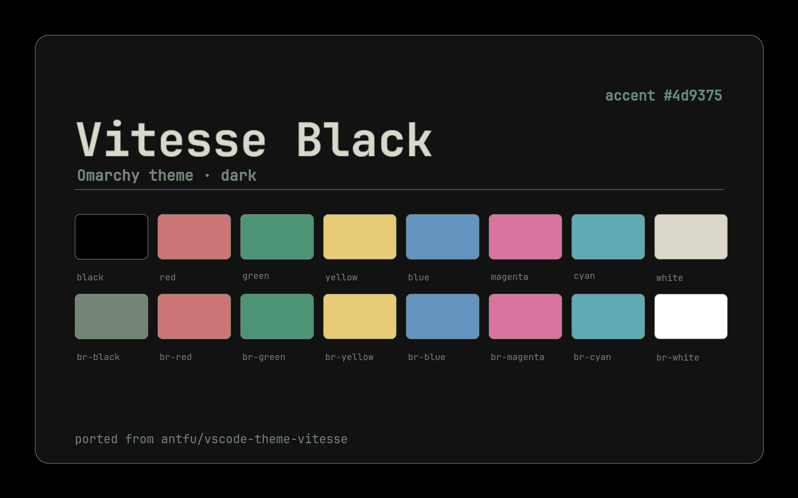

# Vitesse Black

[Vitesse](https://github.com/antfu/vscode-theme-vitesse) for
[Omarchy](https://omarchy.org/).



## Install

```bash
omarchy theme install https://github.com/AkaraChen/omarchy-vitesse-black-theme
```

The theme ships no `backgrounds/`, so applying it keeps your current wallpaper.

## Other variants

- [Vitesse Light](https://github.com/AkaraChen/omarchy-vitesse-light-theme)
- [Vitesse Light Soft](https://github.com/AkaraChen/omarchy-vitesse-light-soft-theme)
- [Vitesse Dark](https://github.com/AkaraChen/omarchy-vitesse-dark-theme)
- [Vitesse Dark Soft](https://github.com/AkaraChen/omarchy-vitesse-dark-soft-theme)

## Neovim and VS Code

This repository holds only colors. For the matching Neovim colorscheme, install
[qshan-li/neovim-theme-vitesse](https://github.com/qshan-li/neovim-theme-vitesse)
with `opts = { theme = "black" }`. For VS Code, use
[antfu.theme-vitesse](https://marketplace.visualstudio.com/items?itemName=antfu.theme-vitesse).
The palette generator and editor adapters live in
[AkaraChen/omarchy-vitesse](https://github.com/AkaraChen/omarchy-vitesse).

## Credits

- Palette and original design: [antfu/vscode-theme-vitesse](https://github.com/antfu/vscode-theme-vitesse) (MIT)
